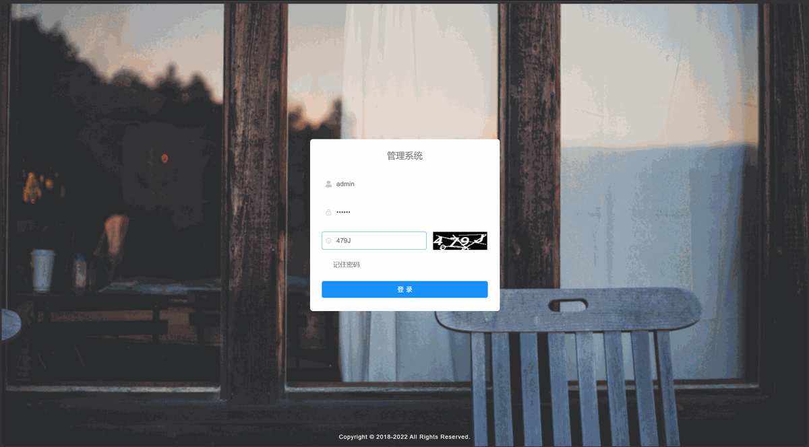
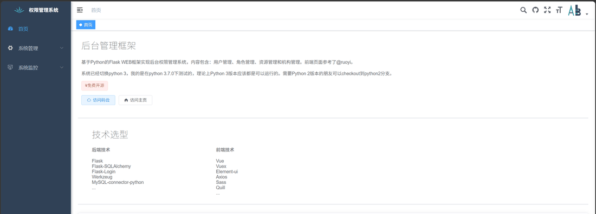

# Gitea/GitLab + Jenkins + Kubernetes（containerd）CI/CD 实践

从代码托管平台拉取源码，用仓库里的 `Jenkinsfile` 驱动 Jenkins 完成构建与部署，最终在 Kubernetes 集群里通过 containerd 运行应用，并用 Service/Ingress 对外访问。

## 链路

```text
Gitea / GitLab（源码）
        │  webhook 或手动触发
        ▼
Jenkins（Pipeline：拉代码 → 装依赖 → 构建镜像 → 推送镜像仓库）
        │  kubectl / kustomize
        ▼
Kubernetes API Server ──▶ 节点 kubelet ──▶ containerd ──▶ Pod
                                                        │
                                              Service / Ingress
                                                        │
                                                     浏览器访问
```

## 真实构建记录

Jenkins `#53` 成功构建：Gitea 检出、依赖安装、前端打包、镜像构建均已完成；部署阶段当时是占位输出，尚未真正发布到集群。


## 已验证流水线（#11）

真实跑通的 4 阶段流水线：Gitea 检出 → uv 安装依赖 → nerdctl/buildkit 构建镜像 → 部署占位。


- 构建 #11，SUCCESS，约 4 分 45 秒
- 镜像：`crpi-m67ogm8wgcr0rh38.cn-hangzhou.personal.cr.aliyuncs.com/tanchenrui/webapp:da5526f`（已推送到阿里云 ACR）
- 详细记录见 [docs/JENKINS-PIPELINE.md](docs/JENKINS-PIPELINE.md)

## 快速开始

1. Jenkins 新建 Pipeline 任务，SCM 指向 Gitea/GitLab 仓库；
2. Script Path 选择 `webapp/Jenkinsfile`（#53 原始文件）或 `ci/Jenkinsfile.lab`（适配本仓库目录）；
3. 配置凭据：镜像仓库账号、集群 kubeconfig；
4. 触发构建，流水线完成镜像构建与推送；
5. 部署并访问：

```bash
kubectl kustomize deploy/k8s/overlays/staging | kubectl apply -f -
kubectl -n webapp-staging rollout status deployment/webapp --timeout=180s
kubectl -n webapp-staging port-forward svc/webapp 8080:80
# 浏览器打开 http://127.0.0.1:8080
```

生产环境把 `staging` 换成 `production`、命名空间换成 `webapp`。

## 仓库结构

```text
.
├── webapp/                          # Flask + Vue 示例应用
│   ├── Jenkinsfile                  # 流水线（#11 验证版：检出 → uv 依赖 → nerdctl 构建并推送 ACR → 部署占位）
│   ├── dockerfile                   # 多阶段：node:18 构建 UI → python:3.11 运行
│   ├── app/                         # Flask 后端（路由、模型、RBAC）
│   ├── ui/                          # Vue 2 + Element UI 前端
│   └── tests/                       # pytest 用例
├── ci/                              # 场景化 Jenkinsfile
│   ├── Jenkinsfile.lab              # 实验环境：本地路径、简化参数
│   ├── Jenkinsfile.hardened         # 加固版：11 阶段，含扫描与质量门禁
│   └── Jenkinsfile.release          # 发布版：digest 部署、审批入口
├── deploy/
│   ├── k8s/                         # K8s 清单（Kustomize）
│   │   ├── kustomization.yaml       # 管理员入口：namespace.yaml + base
│   │   ├── namespace.yaml           # Namespace `webapp`
│   │   ├── secret.example.yaml      # Secret 模板（数据库/Session，勿提交真实值）
│   │   ├── mysql.yaml               # MySQL：StatefulSet + Service
│   │   ├── mysql-backup-cronjob.yaml# MySQL 备份：CronJob + 备份 PVC
│   │   ├── jenkins-rbac.yaml        # SA `jenkins-deployer` + webapp/webapp-staging 的 Role/RoleBinding
│   │   ├── jenkins-release-rbac.yaml# SA `jenkins-release`（仅受信发布 Job 使用）
│   │   ├── base/                    # 应用基线（namespace: webapp）
│   │   │   ├── kustomization.yaml   # 汇总下列资源
│   │   │   ├── serviceaccount.yaml  # ServiceAccount `webapp`
│   │   │   ├── configmap.yaml       # ConfigMap `webapp-config`（非敏感配置）
│   │   │   ├── pvc.yaml             # PVC `webapp-uploads`（上传目录）
│   │   │   ├── deployment.yaml      # Deployment `webapp`（镜像/探针/资源/卷）
│   │   │   ├── service.yaml         # Service `webapp`（ClusterIP）
│   │   │   ├── ingress.yaml         # Ingress `webapp`（域名 + TLS）
│   │   │   ├── networkpolicy.yaml   # 默认拒绝 + 放行 webapp/mysql
│   │   │   ├── pdb.yaml             # PodDisruptionBudget `webapp`
│   │   │   └── hpa.yaml             # HorizontalPodAutoscaler `webapp`
│   │   └── overlays/
│   │       ├── staging/
│   │       │   ├── kustomization.yaml # namespace webapp-staging；replicas=1；删 HPA；改 PDB/Ingress 域名
│   │       │   └── namespace.yaml     # Namespace `webapp-staging`
│   │       └── production/
│   │           └── kustomization.yaml # namespace webapp；复用 base
│   ├── helm/webapp/                 # 可选 Helm Chart（与 Kustomize 二选一）
│   ├── jenkins/                     # Jenkins 部署、JCasC、Job DSL
│   └── containerd/                  # containerd 安装、配置与校验脚本
├── ops/                             # 集群巡检脚本与测试
└── docs/                            # 架构、部署、运维、证据与边界说明
```

## 当前范围（设计 vs 实跑）

| 能力 | 状态 |
| --- | --- |
| Gitea/GitLab 源码检出 | #53 已运行 |
| Jenkins 动态 Agent 构建 | #53 已运行 |
| 镜像构建 | #53 已运行 |
| 镜像推送（阿里云 ACR） | ✅ #11 已运行 |
| Kustomize 部署到 Kubernetes | 脚本支持，待实跑 |
| containerd 拉取并运行 Pod | ✅ 已运行 |
| Service / Ingress 访问 | ✅ 已运行 |

## 已验证的事实

- Jenkins `#11` 构建成功：代码检出、依赖安装、Vue 打包、镜像构建并推送阿里云 ACR（`webapp:da5526f`）
- containerd 拉取镜像并运行 Pod 已跑通，Service / Ingress 可正常访问
- GitHub Actions：后端测试、发布回归、CodeQL 当前通过

## 界面

| 应用登录页 | 应用首页 |
| --- | --- |
|  |  |

更多截图见 [docs/JENKINS-UI.md](docs/JENKINS-UI.md)。

## 文档

| 文件 | 用途 |
| --- | --- |
| [docs/DEPLOYMENT.md](docs/DEPLOYMENT.md) | 环境准备、Secret、数据库、部署与排障 |
| [docs/ARCHITECTURE.md](docs/ARCHITECTURE.md) | 拓扑与组件职责 |
| [docs/OPERATIONS.md](docs/OPERATIONS.md) | 巡检、备份与恢复 |
| [docs/IMAGES.md](docs/IMAGES.md) | 镜像清单与同步站地址 |
| [docs/evidence/build-53/README.md](docs/evidence/build-53/README.md) | #53 构建证据与边界 |

## 说明

- `webapp/Jenkinsfile` 按字节保留 #53 原文件，路径与变量以该文件为准；
- 部署前请确认 kubeconfig、命名空间和镜像地址已替换为你的环境。
