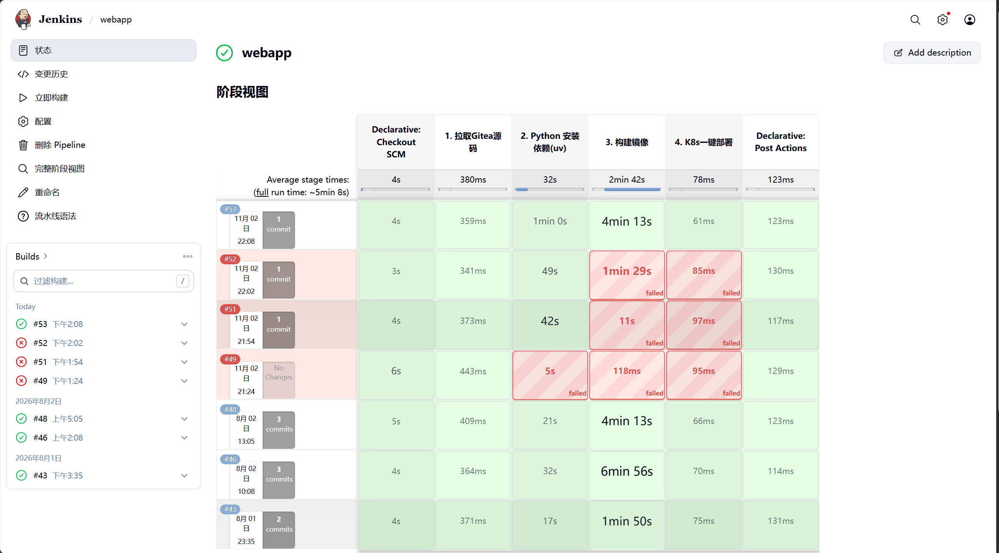
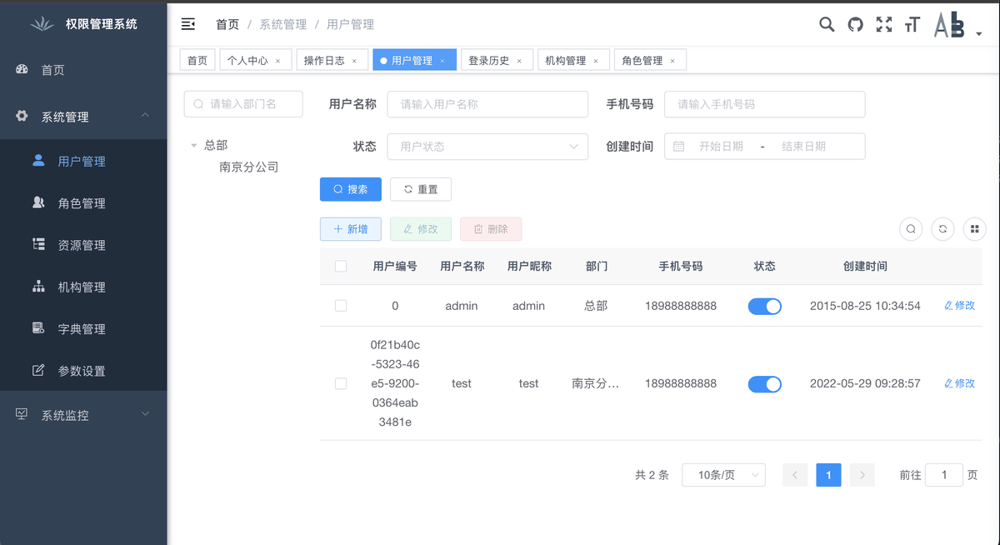
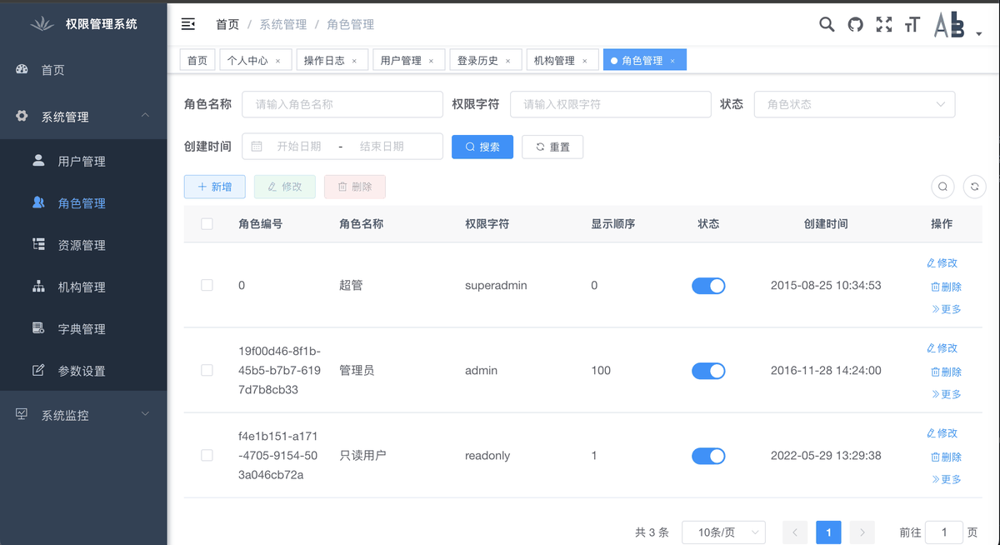
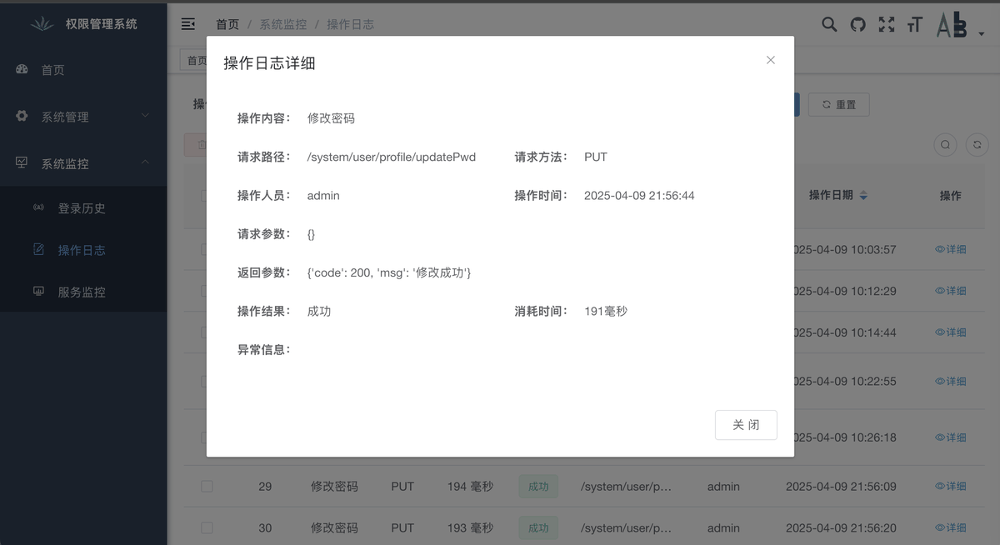
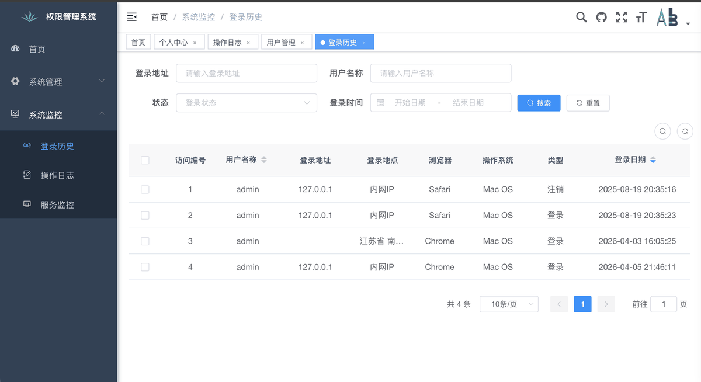

# 三节点 Kubernetes 云计算运维与 Jenkins 持续集成实践

基于 **一个三节点 Kubernetes 集群 + 一台 NFS/Gitea 虚拟机**的运维实验项目。Jenkins 动态创建 Agent Pod，从内网 Gitea 检出源自 Gitee 的 Flask/Vue 示例应用，使用 nerdctl + BuildKit 构建镜像，由 containerd 管理节点容器与镜像。GitHub 保存项目代码、部署模板、运行证据和运维文档。

**最近提供的真实运行记录：Jenkins webapp #53，2026-11-02，SUCCESS。** 已验证代码检出、依赖安装、前端打包、镜像构建与本地导入。该版本没有执行镜像推送或 Kubernetes 自动发布；“K8s一键部署”阶段仍是占位输出。



## 发布设计

主发布统一使用 **Kustomize**，入口为 [独立发布 Job](ci/Jenkinsfile.release)。Helm 仅作可选安装示例，不与 Kustomize 同时管理同一套资源。发布身份、步骤、恢复和证据要求见 [发布与恢复规程](docs/RELEASE-RUNBOOK.md)。新流程尚待集群验收。

## 实际架构


- Kubernetes：3 个节点；日志确认构建 Pod 调度到 `k8s-master`，其余节点名称、资源和角色待填写资产清单。
- 独立 VM：承载 Gitea与 NFS；具体哪些 PVC 使用 NFS 需要现场清单确认。
- Gitee：示例应用的上游来源，不等于当前 Jenkins 的实际检出地址。
- Gitea：部署在内网 VM，托管引入后的应用代码，是 #53 实际检出地址。
- GitHub：维护和展示流水线、部署配置、运维工具与文档；没有证实三个平台之间存在自动同步或容灾切换。
- Jenkins：动态 Agent 包含 python、nerdctl、buildkitd、jnlp；#53 位于 `jenkins-agent` 命名空间。
- 当前构建绑定节点，使用 privileged sidecar 和宿主机 containerd socket，仅适合可信实验代码。
- NFS/Gitea 同机属于单点依赖；三节点不等于控制平面或存储已实现高可用。

**代码来源**：Gitee 是应用上游，Gitea 是内网应用仓库，GitHub 是工程项目仓库。三者职责不同，不描述为主备切换。

## 应用界面

Flask + Vue 权限管理系统，覆盖登录、用户 / 角色 / 机构管理与审计日志。以下截图来自本项目的运行环境，数据为演示数据。

| 首页概览 | 登录页 |
| --- | --- |
|  |  |

| 用户管理 | 角色管理 |
| --- | --- |
|  |  |

| 操作日志 | 登录历史 |
| --- | --- |
|  |  |

## Jenkins 操作画面

| 任务列表 | 新建流水线 |
| --- | --- |
|  |  |

| Pipeline script from SCM | 插件管理 |
| --- | --- |
|  |  |

截图来自 Jenkins 2.541.1 的操作界面；构建结果以顶部 #53 阶段视图为准，逐项配置说明见 [docs/JENKINS-UI.md](docs/JENKINS-UI.md)。

## 能力状态

| 能力 | 当前状态 | 依据 |
| --- | --- | --- |
| Gitea → Jenkins 动态 Agent | 已运行 | #53 控制台（从 Gitea 拉取） |
| 依赖安装、Vue 打包、镜像构建 | 已运行，有构建告警 | Loaded image 与 SUCCESS |
| NFS/Gitea VM、三节点集群 | 用户确认的环境 | [资产模板](ops/inventory.example.yaml)，待补巡检报告 |
| 镜像推送、K8s 发布、健康检查 | #53 未执行 | 部署阶段只有 echo |
| Rootless、扫描、digest 发布与恢复 | 加固候选，未集群验收 | [候选流水线](ci/Jenkinsfile.hardened) |
| Kustomize/Helm、监控告警 | 已有模板，部署待验证 | [deploy/](deploy/) |
| 节点/Pod/PVC 巡检 | 已编写，有本地回归测试 | [巡检工具](ops/inspect_cluster.py) |
| 备份恢复、故障演练 | 手册已编写，待执行 | [运维手册](docs/OPERATIONS.md) |

## 文件入口

| 文件 | 用途 |
| --- | --- |
| [webapp/Jenkinsfile](webapp/Jenkinsfile) | 本次上传的 #53 基线原文件，按字节保留 |
| [webapp/dockerfile](webapp/dockerfile) | 本次上传的多阶段构建原文件，按字节保留 |
| [ci/Jenkinsfile.lab](ci/Jenkinsfile.lab) | 基于原文件适配 GitHub 的 webapp/ 目录，仅构建 |
| [ci/Jenkinsfile.hardened](ci/Jenkinsfile.hardened) | 可选加固候选，须独立 Job 验收 |
| [webapp/dockerfile.production](webapp/dockerfile.production) | 候选使用的 Gunicorn、非 root 镜像 |
| [#53 证据](docs/evidence/build-53/README.md) | commit、文件哈希、日志及证明边界 |
| [架构说明](docs/ARCHITECTURE.md) | 拓扑、组件职责与风险 |
| [运维手册](docs/OPERATIONS.md) | 巡检、排障、备份恢复与演练 |

## 复现入口

#53 使用的 Gitea 应用仓库将 Jenkinsfile、dockerfile、pyproject.toml 放在根目录；本仓库放在 webapp/ 下。**修改 Script Path 不会自动改变工作目录。** 本次只导入两个文件与日志，Gitea commit `caa95a0…` 的整套源码没有同步到这里，不能把 #53 当作当前 GitHub HEAD 的构建证明。

保留现有 Gitea Job 时使用原始文件。从 GitHub 新建实验 Job 时，配置 Pipeline script from SCM、当前仓库、main 分支，Script Path 选择 `ci/Jenkinsfile.lab`。它会进入 webapp/ 后构建，首次执行仍需验证。默认原始 dockerfile 使用 `python start.py`，与当前 GitHub 应用的生产运行要求不同；发布前使用并验证 production 镜像。

原文件固定 IP 是当时网络排障的临时措施，不能保证长期有效；先检查节点 DNS、CoreDNS 与代理配置，见运维手册。

```bash
# 只读巡检：不读取 Secret/日志，不修改集群
python ops/inspect_cluster.py --context YOUR_LAB_CONTEXT --expected-nodes 3 --output reports/cluster-health.json
# 本地测试（ops 测试需要 YAML 解析器）
python -m pip install PyYAML==6.0.3
python -m unittest discover -s ops/tests -v
python -m unittest discover -s ci/tests -v
```

巡检退出码：0 无 error 项，1 发现异常，2 采集失败；warning 仍需检查。发布报告前脱敏资源名称。发布逻辑测试需要 Bash，Windows 设置 BASH_EXE 为 Git Bash 路径。GitHub Actions 配置存在不代表远端已运行通过。

## 下一阶段验收

1. 在新 Job 验证目录适配与镜像启动，保留 commit、构建号和实际耗时。
2. 验证 registry push/pull，再验证 staging rollout、Service/Ingress 与 readiness。
3. 演练错误镜像恢复、PVC/NFS 故障及 Gitea 备份恢复，记录发现与恢复时间。
4. 隔离构建和部署权限，迁移专用构建节点，去除临时 DNS IP 和宿主机 socket 依赖。
5. 在检查稳定运行后启用分支保护，再完善签名、准入及依赖升级。

详见 [加固候选验收](docs/PIPELINE-HARDENING.md)。当前不声称生产级、多集群、高可用或完整 CD 已验收。

## 开源说明

应用基于现有 Flask/Vue 权限系统演进，保留原作者和第三方许可证，见 [LICENSE](LICENSE)、[贡献指南](CONTRIBUTING.md)、[安全说明](SECURITY.md)。
