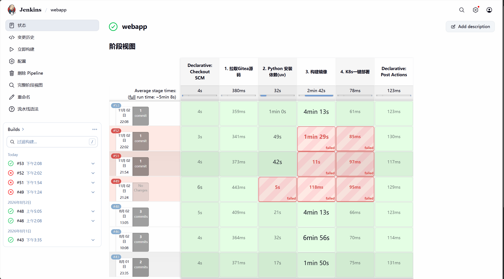
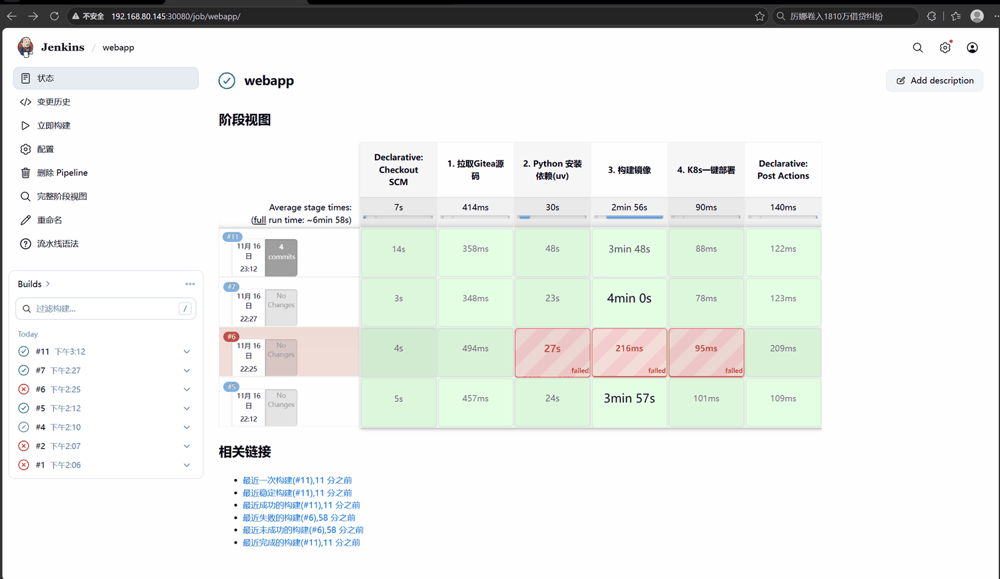

# Gitea/GitLab + Jenkins + Kubernetes（containerd）CI/CD 实践

从代码托管平台拉取源码，用仓库里的 `Jenkinsfile` 驱动 Jenkins 完成构建与部署，最终在 Kubernetes 集群里通过 containerd 运行应用，并用 Service/Ingress 对外访问。

## 链路

```text
Gitea / GitLab（源码）
        │  webhook 或手动触发
        ▼
Jenkins（Pipeline：拉代码 → 装依赖 → 构建镜像 → 推送镜像仓库）
        │  kubectl / kustomize
        ▼
Kubernetes API Server ──▶ 节点 kubelet ──▶ containerd ──▶ Pod
                                                        │
                                              Service / Ingress
                                                        │
                                                     浏览器访问
```

## 真实构建记录

Jenkins `#53` 成功构建：Gitea 检出、依赖安装、前端打包、镜像构建均已完成；部署阶段当时是占位输出，尚未真正发布到集群。



## 已验证流水线（#11）

真实跑通的 4 阶段流水线：Gitea 检出 → uv 安装依赖 → nerdctl/buildkit 构建镜像 → 部署占位。



- 构建 #11，SUCCESS，约 4 分 45 秒
- 镜像：`crpi-m67ogm8wgcr0rh38.cn-hangzhou.personal.cr.aliyuncs.com/tanchenrui/webapp:da5526f`（已推送到阿里云 ACR）
- 详细记录见 [docs/JENKINS-PIPELINE.md](docs/JENKINS-PIPELINE.md)

## 快速开始

1. Jenkins 新建 Pipeline 任务，SCM 指向 Gitea/GitLab 仓库；
2. Script Path 选择 `webapp/Jenkinsfile`（#53 原始文件）或 `ci/Jenkinsfile.lab`（适配本仓库目录）；
3. 配置凭据：镜像仓库账号、集群 kubeconfig；
4. 触发构建，流水线完成镜像构建与推送；
5. 部署并访问：

```bash
kubectl kustomize deploy/k8s/overlays/staging | kubectl apply -f -
kubectl -n webapp-staging rollout status deployment/webapp --timeout=180s
kubectl -n webapp-staging port-forward svc/webapp 8080:80
# 浏览器打开 http://127.0.0.1:8080
```

生产环境把 `staging` 换成 `production`、命名空间换成 `webapp`。

## 仓库结构

```text
.
├── webapp/                 # 示例应用（Flask + Vue）与 Jenkinsfile、Dockerfile
├── ci/                     # 不同用途的 Jenkinsfile（lab / hardened / release）
├── deploy/
│   ├── k8s/                # Kustomize base + staging/production overlay
│   ├── helm/webapp/        # 可选 Helm Chart
│   ├── jenkins/            # Jenkins 安装、JCasC、Job DSL
│   └── containerd/         # containerd 安装与校验脚本
├── ops/                    # 集群巡检工具与测试
└── docs/                   # 架构、部署、操作、证据与边界说明
```

## 当前范围（设计 vs 实跑）

| 能力 | 状态 |
| --- | --- |
| Gitea/GitLab 源码检出 | #53 已运行 |
| Jenkins 动态 Agent 构建 | #53 已运行 |
| 镜像构建 | #53 已运行 |
| 镜像推送（阿里云 ACR） | ✅ #11 已运行 |
| Kustomize 部署到 Kubernetes | 脚本支持，待实跑 |
| containerd 拉取并运行 Pod | 待实跑 |
| Service / Ingress 访问 | 待实跑 |

**暂不包含（相关文件保留但未接入流水线）：**

- 监控告警（`deploy/monitoring/`，Prometheus/Grafana 配置未启用）
- 自动回滚与失败恢复演练（`docs/E2E-VALIDATION.md`、`ops/e2e_drill.sh` 未执行）
- 多环境审批、镜像签名与准入控制

## 已验证的事实

- Jenkins `#53` 构建成功：代码检出、依赖安装、Vue 打包、镜像构建与本地导入
- GitHub Actions：后端测试、发布回归、CodeQL 当前通过
- **未验证**：#53 的部署阶段仍是占位输出，Kubernetes 自动发布与 containerd 拉取运行需要你按上面的命令实际执行一次

## 界面

| 应用登录页 | 应用首页 |
| --- | --- |
|  |  |

更多截图见 [docs/JENKINS-UI.md](docs/JENKINS-UI.md)。

## 文档

| 文件 | 用途 |
| --- | --- |
| [docs/DEPLOYMENT.md](docs/DEPLOYMENT.md) | 环境准备、Secret、数据库、部署与排障 |
| [docs/ARCHITECTURE.md](docs/ARCHITECTURE.md) | 拓扑与组件职责 |
| [docs/OPERATIONS.md](docs/OPERATIONS.md) | 巡检、备份与恢复 |
| [docs/IMAGES.md](docs/IMAGES.md) | 镜像清单与同步站地址 |
| [docs/evidence/build-53/README.md](docs/evidence/build-53/README.md) | #53 构建证据与边界 |

## 说明

- 监控与回滚不是当前交付目标，相关目录保留以便后续扩展，但不要在简历或答辩中声称已经具备；
- `webapp/Jenkinsfile` 按字节保留 #53 原文件，路径与变量以该文件为准；
- 部署前请确认 kubeconfig、命名空间和镜像地址已替换为你的环境。
