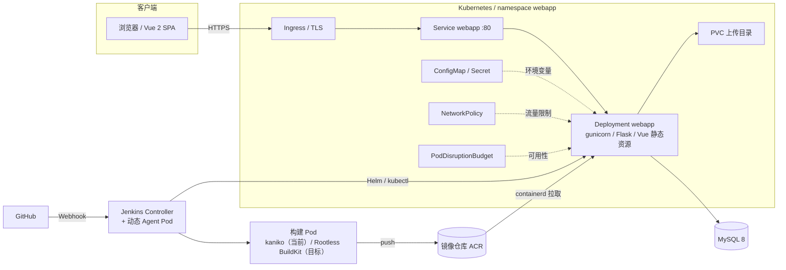
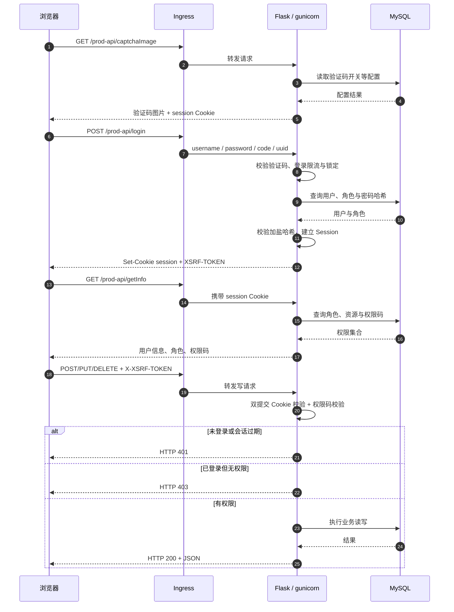
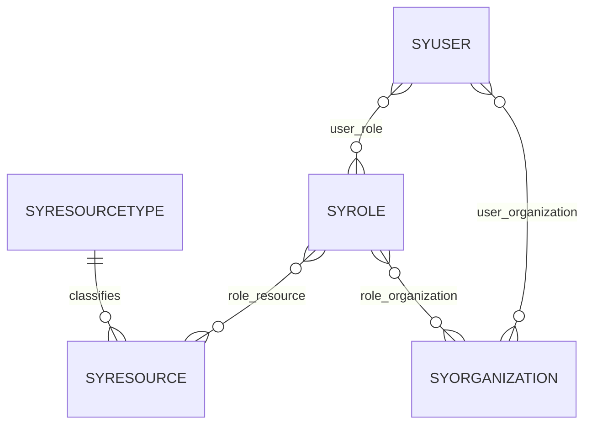
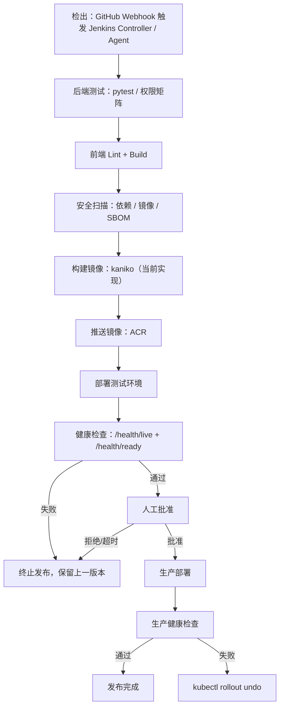

# 架构设计

本文描述示例应用与 CI/CD 链路的整体架构、请求路径、认证授权、数据模型与可靠性设计。目标是让读者能顺着一条请求和一次发布，理解各组件之间的边界与依赖。

## 目标与约束

- Web 层无状态：会话数据保存在签名的 Flask Session Cookie 中，Pod 可水平扩容，不依赖粘性会话。
- 构建与运行分离：Jenkins 使用 kaniko 构建镜像（目标迁移 Rootless BuildKit，图中以紫色虚线标注），运行集群只负责拉取和运行，不向构建任务暴露 containerd socket。
- 配置外置：所有环境差异通过环境变量、ConfigMap 与 Secret 注入，镜像不可变。
- 安全默认：RBAC、CSRF、HttpOnly Cookie、非 root 容器、只读根文件系统。
- 可回滚：镜像使用不可变 tag，Deployment 保留历史版本，健康检查失败时回滚。

## 组件图

## 请求链路

一次页面请求依次经过：

| 跳 | 组件 | 关键动作 |
| --- | --- | --- |
| 1 | 浏览器 → Ingress | HTTPS 终止、按 host/path 路由到 `webapp` Service |
| 2 | Ingress → Service | ClusterIP `80` 转发到 Pod 的 `targetPort: 5000` |
| 3 | Service → gunicorn | 按 Endpoints 负载均衡到某个 Ready Pod 的 worker |
| 4 | gunicorn → Flask | 加载 Session、CSRF 校验、`@permission` 权限校验、执行视图 |
| 5 | Flask → MySQL | SQLAlchemy 连接池执行查询/事务，字符集 `utf8mb4` |
| 6 | 返回 | JSON 响应；静态资源由 Flask 或 Ingress 直接返回 |

与认证相关的 Cookie/Header：

| 名称 | 方向 | 说明 |
| --- | --- | --- |
| `session` | 服务端 → 浏览器 | Flask Session，`HttpOnly`、`SameSite=Lax`，生产加 `Secure` |
| `XSRF-TOKEN` | 服务端 → 浏览器 | 登录成功后下发，前端 JS 可读，用于双提交校验 |
| `X-XSRF-TOKEN` | 浏览器 → 服务端 | 所有 POST/PUT/DELETE 请求必须携带，值取自上面的 Cookie |
| `X-Forwarded-*` | Ingress → 应用 | 传递原始协议、主机与客户端地址，用于日志和限流 |

## 认证与授权时序

授权采用 RBAC：用户通过 `SYUSER_SYROLE` 关联角色，角色通过 `SYROLE_SYRESOURCE` 关联资源；机构也可关联资源，用户最终权限是“角色资源 ∪ 机构资源”的去重集合。接口用 `@permission('system:user:list')` 这类权限码校验，未登录返回 HTTP 401，已登录但缺少权限码返回 HTTP 403。

## 数据模型

| 表 | 关键字段 | 说明 |
| --- | --- | --- |
| `SYUSER` | `ID`、`LOGINNAME`、`PWD`、`SALT`、`STATUS` | 用户；密码为加盐哈希，`STATUS` 控制启用/停用 |
| `SYROLE` | `ID`、`NAME`、`ROLEKEY`、`DATASCOPE`、`STATUS` | 角色；`ROLEKEY` 为 `superadmin` / `admin` / `readonly` |
| `SYRESOURCE` | `ID`、`NAME`、`PERMS`、`URL`、`PATH`、`SYRESOURCE_ID` | 资源树；`PERMS` 是接口/按钮权限码，父子关系构成菜单树 |
| `SYORGANIZATION` | `ID`、`NAME`、`SYORGANIZATION_ID` | 机构树，用于数据范围过滤 |
| `SYUSER_SYROLE` | `SYUSER_ID`、`SYROLE_ID` | 用户-角色关联 |
| `SYROLE_SYRESOURCE` | `SYROLE_ID`、`SYRESOURCE_ID` | 角色-资源关联 |
| `SYUSER_SYORGANIZATION` | `SYUSER_ID`、`SYORGANIZATION_ID` | 用户-机构关联 |
| `SYROLE_SYORGANIZATION` | `SYROLE_ID`、`SYORGANIZATION_ID` | 角色数据范围（机构）关联 |
| `SYRESOURCETYPE` | `ID`、`NAME` | 资源类型：目录 / 菜单 / 按钮 |
| `SYOPERATIONLOG`、`SYONLINE` | 操作人、时间、IP、结果 | 操作审计与登录历史 |
| `SYS_CONFIG`、`SYS_DICT_TYPE`、`SYS_DICT_DATA` | 键值、字典项 | 运行参数与字典数据 |

图中 MySQL 8 使用 PersistentVolume 并配置定时备份；当前示例提供容器 MySQL 与托管实例两种落地方式，生产建议使用托管实例或 PV + 备份。

## CI/CD 流程

- 阶段顺序与 `webapp/Jenkinsfile` 一致：检出 → 后端测试 → 前端 Lint/Build → 安全扫描（含 SBOM）→ 构建镜像 → 推送 → 部署测试环境 → 健康检查 → 人工批准 → 生产部署/回滚。Gitea 可作为自建替代，替换 Webhook 来源与凭据即可。
- 当前构建使用 kaniko，在普通 Pod 内完成，不使用 privileged 容器，也不挂载宿主机 containerd socket；Rootless BuildKit 是目标方案，迁移完成前图中仅以虚线标注，二者可替换。镜像 tag 使用 Git commit 短 SHA。
- 推送与部署凭据来自 Jenkins Credentials；人工批准使用 Jenkins `input`，超时或拒绝则不进入生产。
- 当前发布是 Kustomize 渲染 + `kubectl apply`（`deploy/k8s/overlays/{staging,production}`），没有 Argo CD/Flux 之类的持续协调器，因此不宣称 GitOps；回滚使用 `kubectl rollout undo`。

## 可靠性设计

| 机制 | 设计 | 目的 |
| --- | --- | --- |
| 存活探针 | `GET /health/live`，只检查进程与事件循环 | 进程假死时重启容器 |
| 就绪探针 | `GET /health/ready`，检查数据库连接等关键依赖 | 依赖不可用时摘除流量，避免 5xx |
| PDB | `minAvailable: 1`（多副本时按副本数调整） | 节点维护/驱逐时保留可用实例 |
| NetworkPolicy | 默认拒绝，仅放行 Ingress、DNS、MySQL 等必要流量 | 缩小横向移动面 |
| 滚动更新 | `maxSurge: 1`、`maxUnavailable: 0`，Ready 后才接入流量 | 发布过程不中断 |
| 优雅终止 | `terminationGracePeriodSeconds` 覆盖 gunicorn `--graceful-timeout` | 处理完在途请求再退出 |
| 可写卷 | 根文件系统只读，`/tmp` 用 emptyDir，上传目录挂 PVC | 满足只读根文件系统的同时保留上传能力 |
| 无状态会话 | Session 在签名 Cookie 中，多副本共享同一 `SECRET_KEY` | 无需粘性会话或共享 Session 存储 |
| 资源配额 | Deployment 设置 requests/limits，避免单 Pod 挤占节点 | 提升调度稳定性与可预测性 |

## 可观测性

- 健康检查：`/health/live` 用于存活判断，`/health/ready` 用于就绪判断，两者都不应返回敏感信息。
- 日志：应用日志输出到 stdout/stderr，由集群日志采集；级别由 `LOG_LEVEL` 控制，禁止打印密钥与 Cookie。
- 审计：登录历史、操作日志写入数据库，记录操作人、时间、IP、结果与关键参数。
- 指标与告警：图中包含 Prometheus、日志系统、Grafana 告警与操作审计；当前已落地健康检查、日志与数据库审计，Prometheus 指标与 JSON 结构化日志仍在 Roadmap。

## 已知限制

- Vue 2 已 EOL，前端框架升级尚未完成。
- 数据库结构仍依赖手工导入 `db.sql`，尚未接入 Flask-Migrate / Alembic。
- Prometheus 指标与 JSON 结构化日志尚未落地。
