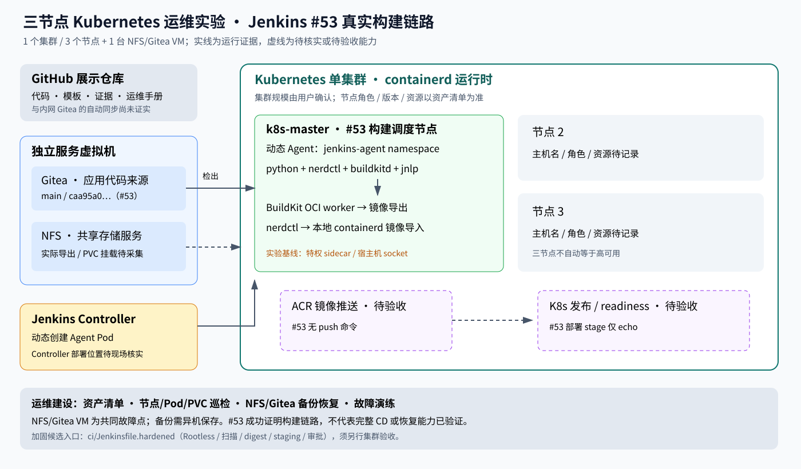

# 实际实验环境与架构边界

用户于 2026-11-02 确认：一个 Kubernetes 集群、三个节点，另有一台 VM 提供 NFS/Gitea。不是三个独立集群。节点角色、资源和版本以现场巡检为准。

## 已证实的执行链

Jenkins 从 Gitea 获取 Jenkinsfile → 创建动态 Agent → 检出 caa95a0eb76b2046eb9ed2acdbae54133971133f → 安装依赖 → nerdctl/BuildKit 构建 → 本地导入镜像 → SUCCESS。

镜像名字包含 ACR 地址不等于上传 ACR。原始脚本没有 push，部署 stage 只有 echo，因此图中 registry 和发布使用虚线。GitHub 是展示仓库，未证实与内网 Gitea 自动同步。

## 运维边界

- 三节点提供调度与故障演练基础；控制平面/etcd 拓扑未确认，不声称高可用。
- NFS/Gitea 同机共享故障域，备份必须保存在其他主机或对象存储。具体挂载路径、容量与访问权限填写资产清单。
- #53 Agent workspace 使用 emptyDir，不能据此声称 workspace 已挂载 NFS。
- 构建绑定 k8s-master、使用 privileged sidecar 与宿主机 socket，后续应迁移专用节点并隔离部署权限。
- 原文件 nerdctl.privileged 位于容器顶层，不是标准 Container 字段；兼容版本已移至 securityContext.privileged。buildkitd 的原 securityContext 是有效字段。

## 候选交付方案

ci/Jenkinsfile.hardened 与 webapp/dockerfile.production 保存上一轮加固方案，包括 Rootless BuildKit、测试扫描、staging、审批和 digest 发布。这套代码未由 #53 执行，须独立 Job 验收。

先填写 [资产清单](../ops/inventory.example.yaml)，执行 [巡检](../ops/inspect_cluster.py)，再按 [运维手册](OPERATIONS.md) 与 [加固说明](PIPELINE-HARDENING.md) 保存实际结果。
