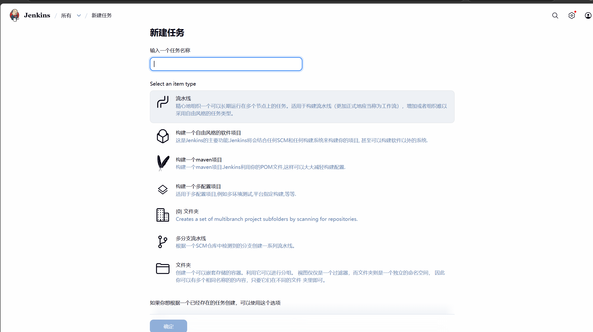
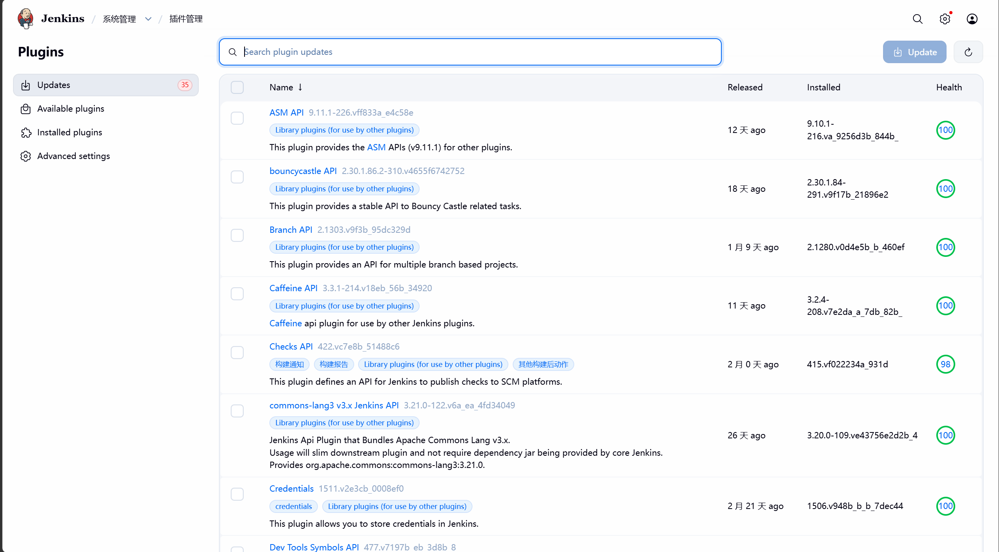
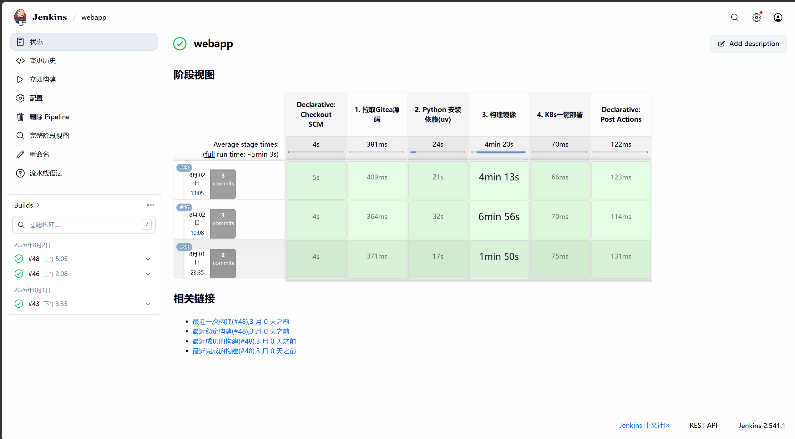

# Jenkins 界面与配置速览

以下截图来自实际部署的 Jenkins（2.541.1，中文界面），用于对照配置步骤快速定位菜单位置。命令与完整步骤仍以 [deploy/jenkins/README.md](../deploy/jenkins/README.md) 为准。

## 1. 登录页


- Helm 安装：管理员密码在 `kubectl -n jenkins exec svc/jenkins -c jenkins -- cat /run/secrets/chart-admin-password`
- 包安装：`/var/lib/jenkins/secrets/initialAdminPassword`
- 首次登录后立即改密，并关闭匿名访问

## 2. 首页与构建历史


图中两个 Job：

- `hello`：最小连通性验证（确认 Controller 与 Agent 正常）
- `webapp`：本仓库流水线，`#48` 为最近一次成功构建

“构建执行状态 0/2”表示当前没有排队或运行中的构建；构建耗时、成功率可用于判断 Agent 资源是否充足。

## 3. 新建任务



选择 **流水线（Pipeline）**，不要选自由风格项目——本仓库的发布逻辑全部在 `webapp/Jenkinsfile` 中。

## 4. 流水线配置（源码管理）


关键项：

| 项 | 值 |
| --- | --- |
| 定义 | Pipeline script from SCM |
| SCM | Git |
| Repository URL | `https://github.com/aggresgesn-wq/jenkins-github-k8s-containerd.git` |
| Credentials | 私有仓库需选择凭据；公开仓库可留空 |
| Branch Specifier | `*/main` |
| Script Path | `webapp/Jenkinsfile` |
| 构建触发器 | GitHub hook trigger for GITScm polling |

> 仓库已从 `jenkins-gitea-k8s-containerd` 改名为 `jenkins-github-k8s-containerd`，旧 URL 会重定向，但建议直接填新地址。

## 5. 插件管理




- 必需插件：Kubernetes、Pipeline、Git、GitHub、Credentials Binding、JUnit、Configuration as Code、DingTalk（可选）
- 截图中 35 个可更新插件不影响当前构建；生产升级前先备份 `JENKINS_HOME`，并在测试实例验证
- 建议固定插件版本（Helm values 中显式指定），避免“今天能跑、明天坏掉”

## 6. 构建阶段视图（改造前，仅作对比）



这张是**改造前**的 4 阶段流水线：

```text
Declarative: Checkout SCM → 1. 拉取Gitea源码 → 2. Python 安装依赖(uv) → 3. 构建镜像 → 4. K8s一键部署
```

它只完成“装依赖 + 构建镜像”，没有测试、扫描、推送、部署与回滚。

当前 `webapp/Jenkinsfile` 已扩展为 11 个阶段：

```text
1 检出代码
2 后端测试（pytest + JUnit）
3 前端 lint 与构建
4 源码/依赖安全扫描（bandit、pip-audit、硬编码凭据）
5 清单校验（helm lint、kubeconform、kubectl diff）
6 构建并推送镜像（kaniko，输出 digest）
7 镜像扫描与 SBOM（trivy、syft）
8 部署测试环境（kustomize + digest）
9 测试环境健康检查
10 生产发布审批（仅 main + 人工批准）
11 生产部署与健康检查（失败自动回滚）
```

对应代码见 [webapp/Jenkinsfile](../webapp/Jenkinsfile)。
