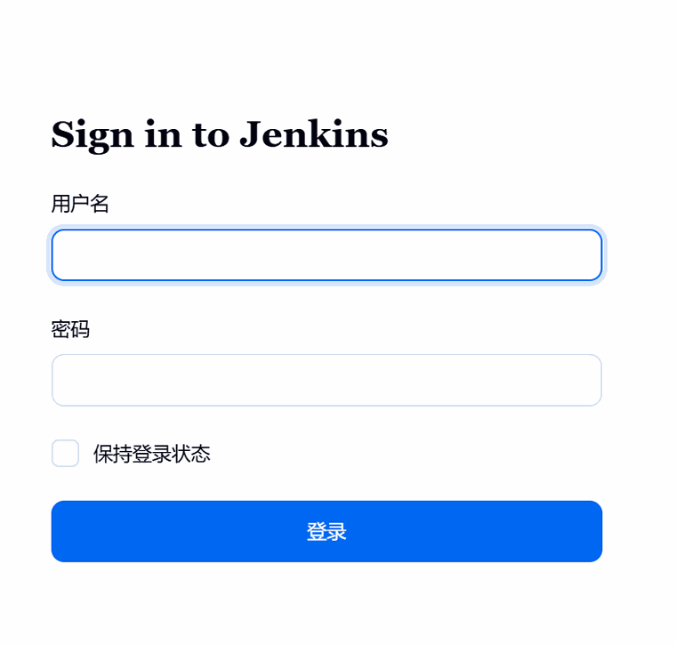
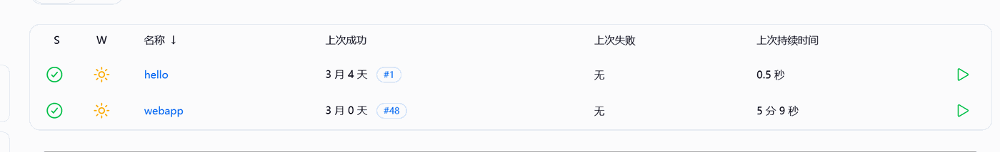
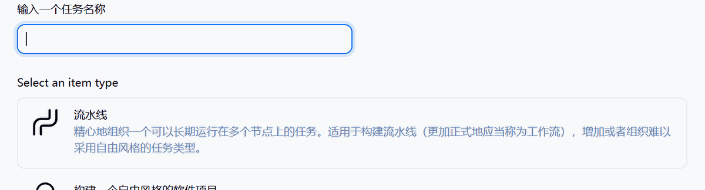
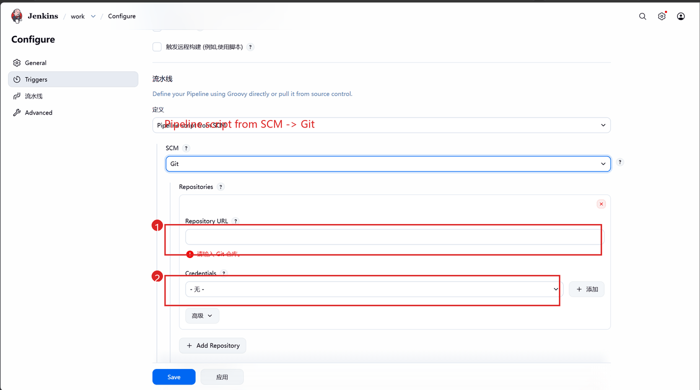
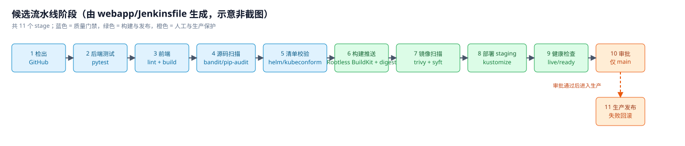
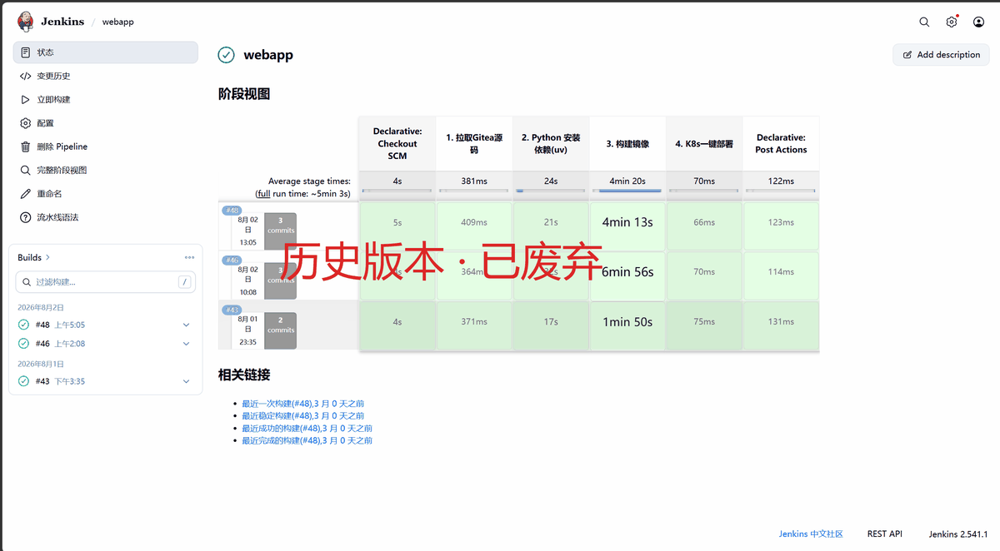

# Jenkins 界面与配置速览

截图来自实际部署的 Jenkins（2.541.1，中文界面），用于对照菜单位置。命令与完整步骤以 [deploy/jenkins/README.md](../deploy/jenkins/README.md) 为准。

> 图片已裁剪压缩；流程类内容用示意图代替真实截图，避免截图随版本过期造成误导。

## 1. 登录页



- Helm 安装：`kubectl -n jenkins exec svc/jenkins -c jenkins -- cat /run/secrets/chart-admin-password`
- 包安装：`/var/lib/jenkins/secrets/initialAdminPassword`
- 首次登录后立即改密并关闭匿名访问

## 2. 首页与构建历史



`webapp` 是本仓库流水线，`#48` 为最近一次成功构建。`hello` 仅用于验证 Controller 与 Agent 是否连通，可在流水线稳定后删除。

## 3. 新建流水线任务



输入任务名后选择 **流水线（Pipeline）**，不要选自由风格项目——发布逻辑全部在 `webapp/Jenkinsfile` 中。

## 4. 流水线配置（源码管理）



红框对应必填项：

| 编号 | 字段 | 值 |
| --- | --- | --- |
| ① | Repository URL | `https://github.com/aggresgesn-wq/jenkins-cicd-k8s-containerd.git` |
| ② | Credentials | 私有仓库选择凭据；公开仓库可留空 |

同一页面下方还需要设置：

- Branch Specifier：`*/main`
- Script Path：`webapp/Jenkinsfile`
- 构建触发器：*GitHub hook trigger for GITScm polling*

> 截图拍摄时仓库地址字段尚未填写；仓库已改名为 `jenkins-cicd-k8s-containerd`，请直接填上表地址。

## 5. 当前流水线阶段（示意）



该图按 `webapp/Jenkinsfile` 的 11 个 stage 生成，**不是 Jenkins 截图**——真实截图需要在测试环境跑完一次流水线后补拍，直接替换同一文件名即可。

```text
1 检出 → 2 pytest → 3 前端 lint/build → 4 源码扫描 → 5 清单校验
→ 6 kaniko 构建推送 → 7 Trivy 扫描 + Syft SBOM
→ 8 部署 staging → 9 健康检查 → 10 审批（仅 main）→ 11 生产发布与回滚
```

## 6. 插件管理


必需插件：Kubernetes、Pipeline、Git、GitHub、Credentials Binding、JUnit、Configuration as Code、DingTalk（可选）。

- 升级前先备份 `JENKINS_HOME`，并在测试实例验证
- 建议在 Helm values 中固定插件版本，避免“今天能跑、明天坏掉”
- “已安装插件”页可按名称筛选，确认所需插件都在列表中

## 7. 历史版本（已废弃）



改造前的 4 阶段流水线：

```text
Checkout SCM → 1. 拉取Gitea源码 → 2. Python 安装依赖(uv) → 3. 构建镜像 → 4. K8s一键部署
```

它只完成“装依赖 + 构建镜像”，没有测试、扫描、推送、部署与回滚，且代码托管仍写作 Gitea。仅作演进对比，请勿按此配置。

## 8. 图片清单

| 文件 | 说明 |
| --- | --- |
| `01-login.png` | 登录页（裁剪表单区域） |
| `02-dashboard.png` | 首页任务列表 |
| `03-new-pipeline-job.png` | 新建任务，选择 Pipeline |
| `04-pipeline-scm.png` | SCM 配置（含 ① Repository URL、② Credentials 标注） |
| `05-current-build-stages.svg` | 当前 11 阶段示意图 |
| `06-plugin-manager.png` | 插件管理入口 |
| `legacy/01-gitea-build-stages.png` | 改造前流水线（历史） |

架构图的可编辑源文件在 `docs/images/architecture.svg`，历史版本见 `docs/images/legacy/architecture-v1.png`。
