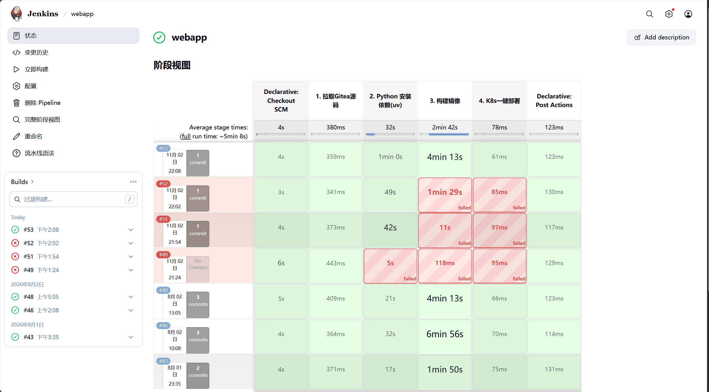

# Jenkins webapp #53 运行证据

来源：用户于 2026-11-02 提供的截图、控制台文本、Jenkinsfile 和 dockerfile。未直接连接 Jenkins 取证。

- 结果：`Finished: SUCCESS`；SCM 为内网 Gitea main（Gitee 的备用拉取源，当时因网络选择该链路）。
- commit：`caa95a0eb76b2046eb9ed2acdbae54133971133f`。
- Agent namespace：`jenkins-agent`；节点选择：`k8s-master`。
- #53 阶段耗时：SCM 4s，第一阶段 359ms，依赖 1min 0s，构建 4min 13s，部署占位 61ms，post 123ms。页面平均耗时不是 #53 精确总耗时，不能据此声称性能优化比例。
- 导出 manifest：`sha256:cfac55dea391e2d79766a6361093ee3b711f2d96ce3eda77bd11b0a1dbcd54f9`。这是日志中的导出 manifest，不是远端仓库已验证的 digest。

文件哈希见 [manifest.json](manifest.json)，关键原文见 [console-excerpts.txt](console-excerpts.txt)。原始控制台由用户本地保存，公共仓库只收录摘要。哈希用于输入追溯，不证明两端完整源码一致。

## 已验证与未验证

已验证：Gitea 检出、动态 Agent、依赖安装、Vue 构建、镜像导出、本地导入、Jenkins 成功。

未验证：测试、扫描、推送 ACR、K8s 更新、readiness/Ingress、生产审批、恢复与备份。原成功提示虽写“构建推送成功”，但脚本没有 push；部署原文为“后续填入kubectl更新镜像命令”。

## 排障经验

配置分别在 Agent 的 hostAliases 与构建命令 --add-host 中设置访问源站的地址。二者位于不同网络/DNS 作用范围；不能只改 Pod hosts 就假定 Dockerfile RUN 同步生效。调整后构建成功，但未提供之前的完整诊断日志，不能断言全部失败根因都是 DNS 污染。

Vue 仍有 gzip 输出同名冲突、bundle 过大和旧依赖告警。仓库已调整 gzip 命名，须在新构建中确认；构建成功不代表告警已解决。
